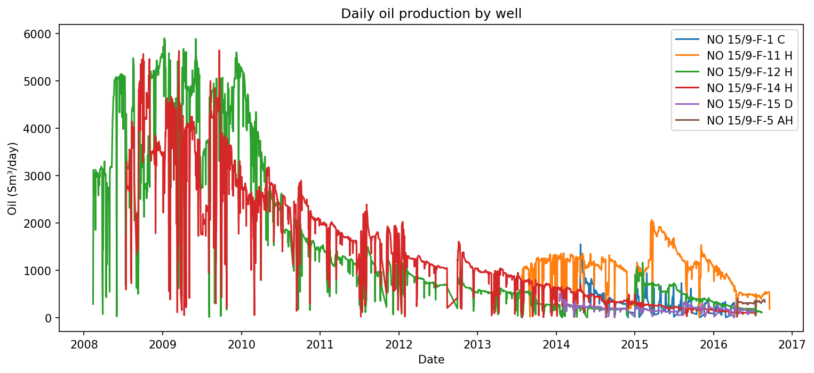
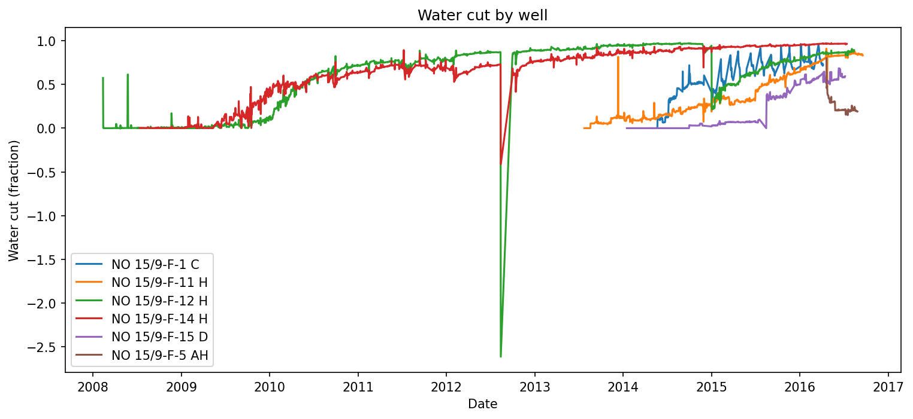
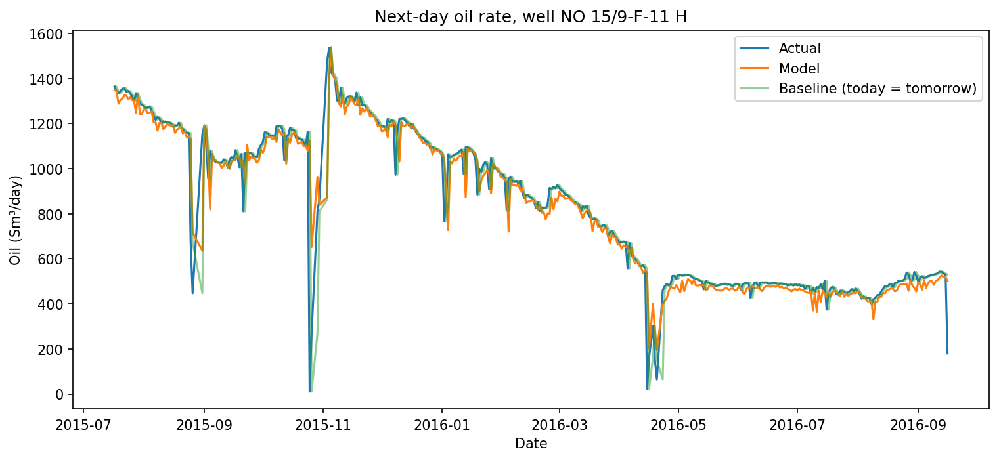

# Oil Production Forecasting on the Equinor Volve Field

Forecasting daily oil production for seven wells in the Volve field (North Sea) with machine learning, and testing whether the models beat a simple "tomorrow equals today" baseline.

**Key finding:** For next-day forecasts, no model beat the baseline. At a 7-day horizon, Gradient Boosting reduced forecast error by **7.4%** compared with the baseline (MAE 43.60 vs 47.07 Sm³/day).

## Problem

Production engineers need reliable short-term forecasts of well rates for planning and for spotting wells that behave unexpectedly. This project asks two questions:

1. Can a machine learning model forecast a well's oil rate better than a persistence baseline (the forecast is simply today's rate)?
2. Does the answer change between a 1-day and a 7-day horizon?

## Data

- **Source:** Equinor Volve open dataset, daily production data per well, used under the Equinor Open Data Licence. Data credit: Equinor.
- **Size:** 15,634 rows, 24 columns, 7 wells, September 2007 to December 2016.
- **Key columns:** well code, date, oil / gas / water volumes, hours on stream, downhole pressure, wellhead pressure, choke size.

## Method

**Cleaning**
- Sorted by well and date, converted dates to a date type.
- Removed rows with missing oil volume and days with zero oil production, so the model only learns from producing days.
- Created `WATER_CUT = water / (water + oil)` and cumulative oil per well.

**Features** (all computed per well, using only information available at the time of the forecast)
- Today's oil rate, the day-to-day change in oil rate, and the 7-day rolling average oil rate.
- Water cut and hours on stream.
- Day-to-day changes in downhole pressure, wellhead pressure and choke size (where present in the data).

**Target.** Instead of predicting the oil rate directly, the models predict the **change** from today's rate to the future rate. The forecast is today's rate plus the predicted change. Predicting the rate directly performed poorly (Random Forest MAE 60.2 vs baseline 21.0 for next-day), because tree-based models cannot predict values outside the range they saw in training, and the wells decline over time.

**Validation.** Time-based split: the earliest 80% of dates for training and the latest 20% for testing. A random split would let the model see the future, which gives unrealistic results.

**Models compared:** Ridge regression, Random Forest, and Gradient Boosting (trained with an absolute-error loss to match the evaluation metric).

**Metric:** Mean Absolute Error (MAE) in Sm³/day, compared against the persistence baseline.

## Results

| Model | Horizon | Baseline MAE | Model MAE | Improvement |
|---|---|---|---|---|
| Ridge | 1 day | 21.01 | 40.80 | -94.2% |
| Gradient Boosting | 1 day | 21.01 | 21.19 | -0.9% |
| Random Forest | 1 day | 21.01 | 25.72 | -22.4% |
| Ridge | 7 days | 47.07 | 64.89 | -37.9% |
| **Gradient Boosting** | **7 days** | **47.07** | **43.60** | **+7.4%** |
| Random Forest | 7 days | 47.07 | 60.61 | -28.8% |

Positive improvement means the model beat the baseline. "7 days" means 7 producing days ahead, because days with no oil production were removed.

## Findings

- **Next-day oil rate is almost entirely explained by today's rate.** The baseline reaches an R² of 0.963, which leaves very little for a model to add. Gradient Boosting matched it (MAE 21.19 vs 21.01).
- **Predicting the change instead of the level made a large difference.** The Random Forest error fell from 60.2 to 25.7 after this change.
- **At a 7-day horizon, Gradient Boosting was the only model that beat the baseline**, by 7.4%. A likely reason is that pressure, choke and water-cut trends carry more information over a longer horizon, and its absolute-error loss is less sensitive to sudden shut-ins and restarts. This explanation has not been tested here.
- Ridge regression and Random Forest were worse than the baseline at both horizons.

## Limitations

- The 7.4% improvement comes from a single time-based split with no cross-validation, so it could change with a different split. It should be treated as indicative, not proven.
- Hyperparameters were not tuned.
- Wells share one global model and one split date. Per-well models were not tested.
- The horizon counts producing days, not calendar days, because zero-production days were removed.

## Next steps

- Cross-validate with several time-based splits and check the result per well.
- Add anomaly detection to flag days where a well deviates from its forecast.
- Test per-well models and tune Gradient Boosting.
- Build a Power BI dashboard of production trends and model results.

## How to run

1. Download the Volve production data (Equinor Volve data village, or a copy on Kaggle).
2. Open `volve_production_forecast.ipynb` in Jupyter, Kaggle or Colab.
3. Update the file path in the first cell, then run all cells.

Requires Python 3, pandas, numpy, matplotlib and scikit-learn.

## Author

Arwa Al Khayari, Petroleum & Natural Gas Engineer.  · [Email](mailto:arwakayari@gmail.com)

## Acknowledgements

Data: Equinor Volve dataset, released under the Equinor Open Data Licence.
